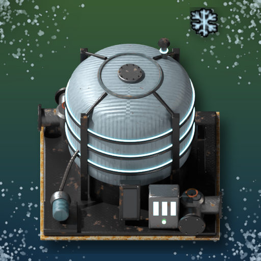
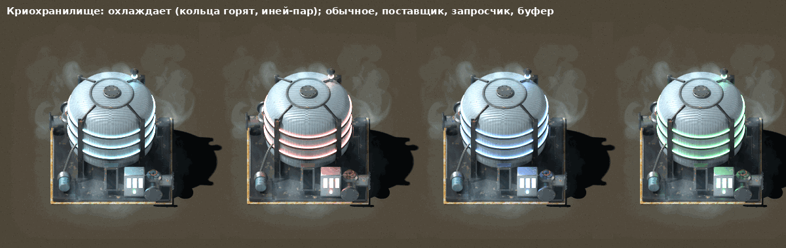
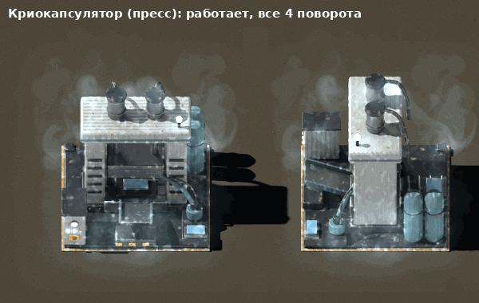
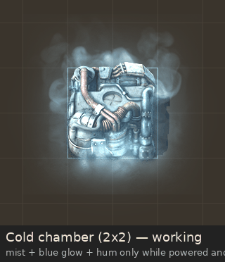

# Gleba Cold Storage

Factorio 2.1 + Space Age mod. Fridges that slow spoilage without removing the challenge.

Gleba is a race against the clock. This mod gives you ways to slow that clock down, and each one comes with its own logistics puzzle.

## Buildings

| Building | Cools to | Runs on | Research |
|---|---|---|---|
| **Cold chamber** (2x2, 12 slots) | 0 °C, up to 3x slower spoilage | 250 kW + 6 water/s; puts out 6 steam/s | Cold chain (agricultural science) |
| **Cryo vault** (3x3, 48 slots) + passive provider, requester and buffer versions | −35 °C, up to 20x slower | free on Aquilo; elsewhere 300 kW + cryo cells | Cryogenic storage (cryogenic science) |
| **Refrigerated wagon** (30 slots) | −10 °C, up to 5x slower | 150 kW from its equipment grid | Cryogenic storage |
| **Cryo-encapsulator** | seals 10 perishables + 1 ice into a block that keeps 10x longer, and thaws them back | 1 MW | Cryo-encapsulation |

| Cryo vault (cooling, by logistic mode) | Cryo-encapsulator |
|---|---|
|  |  |

## Temperature

Every cold store has a temperature, shown in its status. It cools towards its target while it works and drifts back to the planet's own temperature when it stops: Nauvis 15 °C, Gleba 25 °C, Vulcanus 45 °C, Fulgora 10 °C, Aquilo −40 °C. Spoilage halves for every 12.6 °C below 20 °C and speeds up above it, so a dead chamber on Gleba is worse than an open chest. Chambers take about a minute to cool down, vaults about two.

## Steam

A cold chamber is a heat pump: the heat has to go somewhere. It turns its water into 100 °C steam, which runs a steam engine for about 100 kW. **If the steam has nowhere to go, the chamber stops cooling.** Generators share load evenly, so on a grid with other power you need to give chamber steam priority, for example with a circuit-controlled pump on your main steam line.

## Cryo cells

Cryo cells are charged only on Aquilo and thaw back into empty cells within an hour, wherever they are. A vault off Aquilo burns one cell per 3 minutes of cooling and puts the empty cell back into its inventory, ready for the trip back. On Aquilo a vault needs neither power nor cells.

## Fair play

- Science packs are not preserved or frozen (startup setting to allow it).
- Eggs and other items whose spoiling triggers something cannot be frozen.
- Nothing ever becomes fresher than new; freshness carries through freezing and thawing.
- The encapsulator takes no modules or beacons; freeze and thaw recipes have no productivity and do not recycle.
- All slowdowns, cell duration and update rate are mod settings.

## Performance

Containers are visited round-robin with a hard cap of 60 inventory slots per tick, so the cost stays flat however big the base gets. Measured on 2.1.23: 1000 chambers and 300 vaults, all full (26 400 stacks), cost 0.48 ms per tick of script time.

## Requirements

Factorio 2.1 with Space Age.

## Credits

Cryo vault and encapsulator art: [CMA Graphics](https://mods.factorio.com/mod/cma-graphics) by trentmkelly (CC0). Cold chamber art and hum: [Cryo-container](https://mods.factorio.com/mod/simple_refrigerator) by snouz (MIT; Hurricane046 buildings, CC BY 4.0). Ice, snowflake, thaw and wagon doors: [Freezer](https://mods.factorio.com/mod/freezer) by estgamer (MIT). Full list in CREDITS.md.

## Install

From the in-game mod manager once it is on the [Mod Portal](https://mods.factorio.com/mod/gleba-cold-storage), or build a zip from this repository (see [dev/README.md](dev/README.md)).

## License

Code: MIT ([LICENSE](LICENSE)). Graphics and sound keep their own licenses, listed in [CREDITS.md](CREDITS.md).
